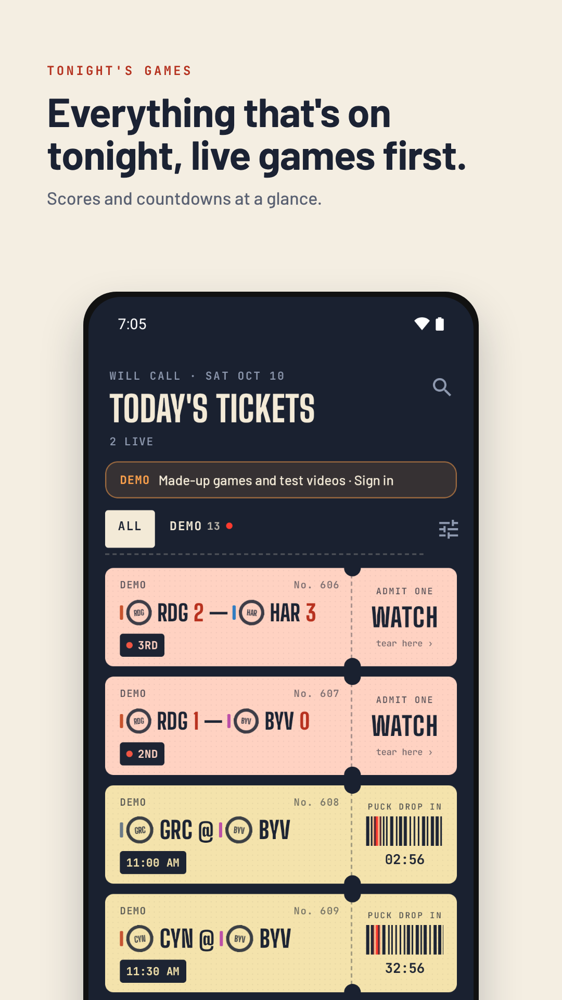
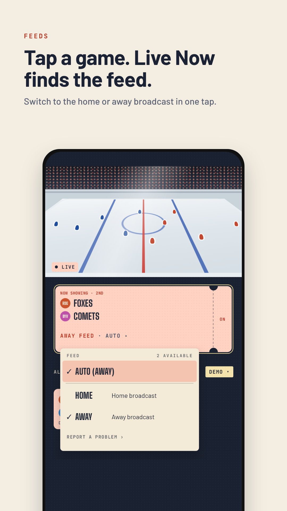
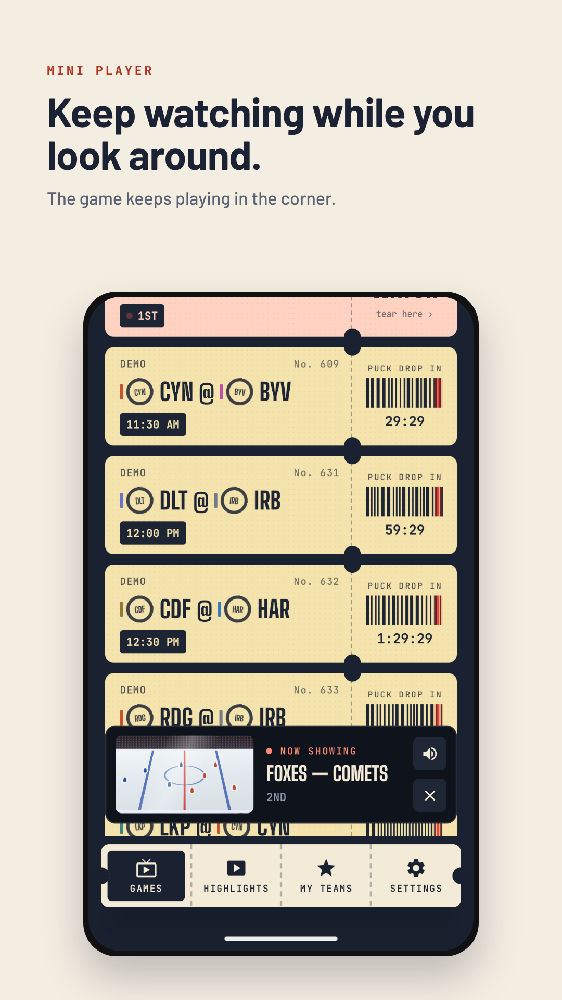
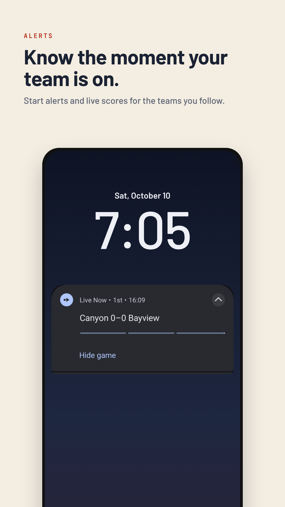

# Live Now

**Sports, organized.** Live Now is an Android app built around the games, not around channels. You see tonight's games first, pick one, and it finds the broadcast for you, using the TV service you already pay for.

> Live Now doesn't provide any streams or channels. Bring your own TV provider login.

Screenshots use the app's demo mode: made-up teams and test videos.

## Tonight, first

Open the app and you see tonight's games, not a channel list. Each game is a ticket.

- **Live games sit on top**, with the score and the period, like "3RD" or "2ND INT".
- **Games still to come** show their start time and a countdown on the ticket stub.
- **Tap WATCH** and Live Now finds the right channel on your TV service and starts the game.
- Filter by league, or jump to the teams you follow.

## The right broadcast, without spoilers

Most games air on more than one feed. Live Now picks one for you.

- **Auto feed** plays the home broadcast by default. One tap on the feed line opens the picker: Auto, Home or Away.
- **No spoilers.** The game you're watching never shows its score, in the player or the mini player. The other games below keep their scores.
- **Score card.** Hold the player and a box score prints out, held back to match your stream so it can't get ahead of what you see.
- **Highlights.** Finished games link to their recaps.

## Keep watching

Swipe the player down and the game shrinks into a mini player at the bottom of the screen.

- Scroll the games list, check other scores or open settings while the game keeps playing.
- Tap the mini player to go back to full size, or close it with the ✕.
- Swipe up in the player for full screen. Pinch to fit or fill, and slide the edges for volume and brightness.

## Know the moment

Follow your teams and Live Now keeps you posted.

- **Live score updates** on the lock screen while your team plays.
- **Hide game** right from the notification if you'd rather not know.
- On the GitHub build, score alerts can also be pushed to every phone in your household.

## Two builds

| | Google Play | GitHub (this page) |
|---|---|---|
| Everything above | ✓ | ✓ |
| Sign in with your TV provider | ✓ | ✓ |
| Updates | Play Store | Built into the app |
| Live Now server mode (Dispatcharr): every channel matched to its game, every feed, quality choices from source down to 360p | | ✓ |
| Android TV app | | ✓ |
| Score alerts pushed to your phone | | ✓ |

The Play version is in closed testing. Want in? Email livenow.factor1@gmail.com.

## Install the GitHub build

1. On your Android phone (Android 8.0 or newer), open the [latest release](https://github.com/TheFactor1/livenow-releases/releases/latest) and download `livenow.apk`.
2. Open it and allow installs from your browser when Android asks.
3. Open Live Now and sign in with your TV provider's login.

After that, the app updates itself. Each release also has a `version.json` with the file's SHA-256, if you want to check the download.

## Coming soon

- **Mercury**, a second look for Live Now.
- **M3U playlist** sign-in.

## Privacy

Live Now has no accounts, no ads and no analytics. Read the [privacy policy](https://thefactor1.github.io/livenow-releases/privacy/).

## Contact

Made by Factor. Built with Claude.
livenow.factor1@gmail.com
